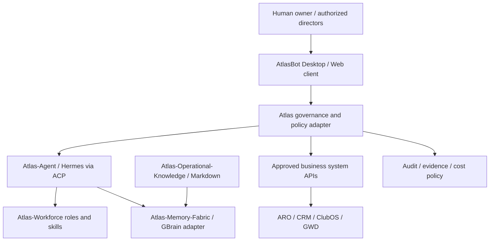

# Atlas Harness — Architecture for the AI-Native Enterprise

**AtlasHub.SI · Intelligence for the Augmented Enterprise**  
**Legal:** [Atlas Global Tech Ltd / ATLASHUB DIGITAL LTD](LEGAL.md) · **Provenance:** [SergioMonteiro-Atlas](https://github.com/sergiomonteiro-atlas) · **License:** [original Atlas materials](LICENSE)  
**Version:** V0.1 · Public architectural preview · 13 November 2026  
**Website:** https://www.atlas-si.com · **Platform status:** integration in progress, **not** a publicly released commercial agent runtime.

The Atlas Harness is the governed architecture that links a multiagent workspace, bounded agent execution, organizational roles, shared memory, approved operational knowledge and transactional business applications. Its purpose is a coherent AI-native enterprise—not another disconnected chatbot collection.

> **Important distinction:** Atlas Harness is our original architecture and integration contract; **AtlasBot Desktop** is the candidate multiagent interface/runtime under evaluation. A browser landing and a GitHub fork are not proof of a fully integrated product.

## Current project map

| Repository | Responsibility | Upstream / licensing caution | Delivery status |
| --- | --- | --- | --- |
| [Atlas-Harness](https://github.com/AtlasHub-Si/Atlas-Harness) | Original reference architecture, governance, orchestration contracts | Atlas original; own licensing decision pending | V0.1 public docs |
| [Atlas-Bot-Desktop](https://github.com/AtlasHub-Si/Atlas-Bot-Desktop) | Desktop / remote multiagent interface **candidate** | Independent Git copy of `nightly-labs/openbot` planned; PolyForm Noncommercial constraints remain | Import in progress; no public Atlas installer |
| [Atlas-Bot](https://github.com/AtlasHub-Si/Atlas-Bot) | Alternative enterprise control plane R&D | Fork of unrelated `CopilotKit/OpenBot`; separate software and licences | Research; not the canonical Desktop |
| [Atlas-Agent](https://github.com/AtlasHub-Si/Atlas-Agent) | Hermes agent runtime, tools and skills; ACP integration | Fork of `NousResearch/hermes-agent`; preserve upstream notices | Local/VPS technical integration |
| [Atlas-Memory-Fabric](https://github.com/AtlasHub-Si/Atlas-Memory-Fabric) | Governed memory, retrieval and provenance | Fork of GBrain; adapter authorization needed | Research |
| [Atlas-Operational-Knowledge](https://github.com/AtlasHub-Si/Atlas-Operational-Knowledge) | Versioned Markdown playbooks and approvals; Obsidian-compatible authoring | Atlas original | Architecture |
| [Atlas-Workforce](https://github.com/AtlasHub-Si/Atlas-Workforce) | Roles, SOULs, templates and skills catalog | Fork of `msitarzewski/agency-agents` | Catalog / integration |
| [Atlas-WorkSwarms](https://github.com/AtlasHub-Si/Atlas-WorkSwarms) | Experimental federation and swarm orchestration | Fork of `ruvnet/ruflo` | Research only |
| [Atlas-Crm-OS](https://github.com/AtlasHub-Si/Atlas-Crm-OS) | Business-unit CRM candidate derived from DeskcommCRM | Fork of `melgarafael/DeskcommCRM` | Separate BU application |
| [atlas-si-website](https://github.com/AtlasHub-Si/atlas-si-website) | Atlas SI public landing, communications and release links | Website asset provenance under review | V0.1 public early-access site |

The existing GWD Cockpit, LearnHouse/ClubOS, ARO, Deskcom-derived CRM and webplayer are **standby or operational applications**, not expendable Harness infrastructure. Their data and Helena-managed services remain isolated from the new AtlasBot pilot.

## Architecture in one view

**ACP = Agent Client Protocol.** An ACP connection runs an agent; it does not, by itself, implement tenant authorization, approval workflows, budgets, accounting or organization-wide audit. These remain Atlas integration requirements.

### Data and control boundaries

- One owner and authorization decision path for each company-wide mission and external side effect.
- Explicit tenant, BU, role, allowed tool set and cost budget; no direct bypass via nested agents.
- Executive memory, approved knowledge, agent working memory and transactional CRM/ARO data remain distinct.
- GBrain indexes knowledge through a governed adapter; Obsidian edits versioned Markdown, not live production databases.
- Production client data, agent identities, credentials and operational IPs do not belong in public GitHub issues.

## Release channels

| Channel | Audience | Current decision |
| --- | --- | --- |
| Architecture / Preview | Public | V0.1 on `atlas-si.com`, early access |
| Internal Lab | AtlasHub operators | One isolated VPS AtlasBot host + separate configured Hermes runtime; test required |
| Community / Open Edition | Future developers | Only Atlas-authored code and third-party components that permit redistribution |
| Enterprise / Cloud | Future customers | Pending commercial rights, security, tenancy, support, legal and billing review |

The `nightly-labs/openbot` source licence is **PolyForm Noncommercial 1.0.0** for current releases. Rehosting, renaming, copying, or running as a client service does not remove those obligations. No Atlas branded public installer or commercial edition is authorized merely by creation of the copy repository.

## Documentation index

- [Platform V0.1 launch and source-of-truth](docs/atlas-platform-v01-release-alignment.md)
- [Reference architecture](docs/architecture.md)
- [Repositories and provenance](docs/repository-map.md)
- [Memory and operational knowledge](docs/memory-knowledge.md)
- [Architecture decision records](docs/adr/0001-atlas-harness-architecture.md)
- [AWS staging and Activate readiness](docs/aws-staging-credits.md)
- [Publication and data security](docs/security-publication.md)
- [Phase 01 acceptance gates](docs/phase-01-roadmap.md)

## Active work

- [Launch issue #14](https://github.com/AtlasHub-Si/Atlas-Harness/issues/14): V0.1 website, Desktop source import, VPS, AWS and communications.
- [VPS consolidation #13](https://github.com/AtlasHub-Si/Atlas-Harness/issues/13): isolate AtlasBot from Helena, preserve four legacy agents and named standby projects.
- [Website release PR #1](https://github.com/AtlasHub-Si/atlas-si-website/pull/1): V0.1 landing and installer gate.

## Governance and contributions

All functional claims require linked test evidence. Changes to contracts and licensing require reviewed ADRs/PRs; preserve upstream LICENSE and NOTICE files and check each subdirectory/package separately. Do not insert actual secrets, customer data, payment values or private staff data into this repository. The Atlas Harness original reference material is not automatically under MIT merely because some of its dependencies are.
