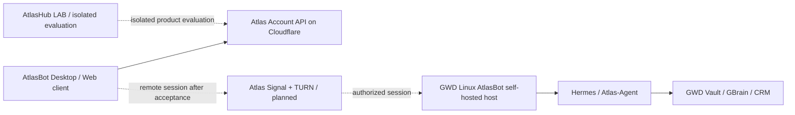

# ADR-0004 — AtlasCloud control plane and GWD independent self-hosted boundary

**Date:** 2026-11-16  
**Status:** Proposed for review (documentation only; no infrastructure GO)  
**Scope:** AtlasHub-Si / Atlas-Harness, Atlas-Bot-Desktop, and GoWorld-Digital integration  
**Supersedes:** The *AWS GWD REFERENCE* deployment assumption in ADR-0003 **for future planning only**. Existing pilots, contracts, or deployments are not automatically changed.

## Decision

Maintain **two separate legal, billing, IAM, network, runtime and data boundaries**:

| Boundary | Atlas product operator | GWD customer installation |
| --- | --- | --- |
| Business / owner | ATLAS GLOBAL TECH LTD | ATLASHUB DIGITAL LTD / GoWorld Digital |
| Source organization | `AtlasHub-Si` | `GoWorld-Digital` |
| AWS | **AtlasCloud**, new separate project/account; AWS identity not yet verified by STS | **Independent** AWS account if/when selected, or independent existing VPS |
| Preferred regional workload deployment | `eu-north-1`, subject to service, billing and account-model verification | Independently selected after cost/security approval |
| Product role | AtlasBot shared identity, control-plane services, distribution, Signal/TURN if approved | First independent AtlasBot Free/Self-Hosted client; own Linux host, Hermes and operational memory |
| Operational data | Only control-plane metadata strictly required for accounts, sessions and connectivity | CRM, cockpit, GBrain, Markdown vaults, operational logs and private application data |
| Deploy authority | Atlas team under an explicit GO | GWD team under its own independent GO |

**No AWS account numbers, IAM principals, secrets, tokens or billing identifiers are to be committed to this public repository.** The names and ownership above are architectural intent, not STS-verified identity claims.

A single person's access to both organizations does not make the AWS accounts interchangeable. Do not reuse AWS CLI profiles, OIDC trust, Terraform state, GitHub environment secrets, encryption keys or billing registries.

## Product topology

- **Account API:** the existing Atlas-managed Cloudflare Worker/D1/R2 design is the shared identity/control-plane candidate. Its presence does not prove production readiness or remote session functionality.
- **Signal/TURN:** required for the current remote topology. Deployments and DNS are gated on functional, security and spending acceptance.
- **Web client:** an interface, **not** a substitute for a running local/remote agent host. An authenticated `/app` alone is not a remote server.
- **GWD host:** uses an AtlasBot release and tenant configuration; it does **not** run inside the AtlasCloud AWS account. Data residency, backups and runtime secrets remain within the GWD boundary.
- **AtlasHub LAB:** optional isolated staging on the existing AtlasHub VPS after fresh capacity, port, volume and backup checks. Protect Helena, Diana, Elisa, Maia, LearnHouse, Cockpit, CRM and other identified services.

## Verified repository evidence (2026-11-16)

The following concerns are based on current `main` file contents read on 2026-11-16; they are **not** claims about running infrastructure:

1. `Atlas-Bot-Desktop/scripts/install-server.sh` sets `RELEASES=https://github.com/nightly-labs/openbot/releases`, expects `OpenBot-...` AppImages and invokes the extracted `openbot-server-setup`. **It cannot be marketed as an Atlas-owned server installer as-is.**
2. `Atlas-Bot-Desktop/docs/self-hosted-server.md` documents the upstream install URL, `openbot` commands, one-time server claims and an example against `api.openbot.run`. The claims/SSH flow is a valuable *design reference* but must be adapted and tested against Atlas-owned endpoints.
3. `Atlas-Harness/deploy/atlasbot-pilot/.env.example` pins `ghcr.io/nightly-labs/openbot:v0.70.0`; `deploy/atlasbot-pilot/compose.yaml` explicitly identifies a technical evaluation image, not an Atlas-built/relicensed binary.
4. `atlas-si-website/app/download/[platform]/route.ts` uses `resolveAtlasDownloads()` and returns an unavailable response if an approved target is absent. Preserve this **fail-closed** distribution behavior until signed/verified Atlas artifacts exist.
5. `Atlas-Harness/docs/adr/0003-lab-consolidation-aws-gwd-rollout.md` and `docs/aws-staging-credits.md` predate this explicit two-account boundary and describe AWS GWD reference as the preferred clean installation. Interpret those AWS passages in light of this ADR after approval; do not rewrite historical decisions as if deployments occurred.

## Work that is independent of AWS, PC or VPS

### P0 — Atlas-owned distribution and supply chain

- [ ] Build a tracked inventory of executable upstream ties: `nightly-labs`, `openbot.run`, `api.openbot.run`, app identifiers, auto-updaters, release manifests and build/signing destinations.
- [ ] Record obligations from actual LICENSE/NOTICE and dependencies before changing attribution or offering commercial binaries. **Do not assume a license merely from product intent or a planned legal entity.**
- [ ] Introduce Atlas-only installer/release source configuration and a CI regression check. Preserve integrity checks, pinned versions, architectures and atomic upgrade/rollback logic.
- [ ] Keep external public download routes fail-closed until CI build provenance, checksums/signatures and legal approval are documented.
- [ ] Test Linux x86_64 and arm64 headless install into a disposable machine; never pipe an unreviewed remote script into privileged execution for a customer.
- [ ] Review provider dependencies and legacy telemetry independently of visual rebranding.

### P0 — Self-hosted onboarding and remote connectivity

- [ ] Specify `create_server_install_command` / one-time claim lifecycle, TTL, replay protection, logs redaction and ownership binding against **Atlas** Account API.
- [ ] Define scoped SSH agent actions: explicit target host, identity, privilege boundary, dry-run inventory, human approval before install, evidence and rollback.
- [ ] Require *no arbitrary root commands*: approved command templates, credential isolation and redacted transcripts.
- [ ] Define remote Signal/TURN acceptance tests: register host, authorize user, connect from Desktop and Web clients, reconnect after restart, revoke, verify tenant isolation.
- [ ] Separate local-only Desktop operation from sign-in-required remote operations and avoid promising the Web client can run agents without a host.

### P1 — GWD as independent tenant/customer

- [ ] Reuse the existing private `GoWorld-Digital/gwd-knowledge-vault` as a source of knowledge contracts; do not create a competing vault.
- [ ] Separate restricted executive and operational knowledge domains; test role-/BU-scoped retrieval and denial of cross-tenant access.
- [ ] Provision GWD host through customer-specific infrastructure after its own review, not through AtlasCloud Terraform.
- [ ] Keep CRM, GBrain, Postgres, operational logs and customer secrets within GWD control.

## AWS readiness gates (not yet authorized)

1. **Verify identities** in each environment independently, using read-only STS `GetCallerIdentity`. Compare the result with a private account register before any write. A ChatGPT MCP "connected" indicator alone is insufficient.
2. **Verify AtlasCloud account model**, project region `eu-north-1`, available regional services, payment plan, entity ownership, IAM/SSO capability and credit eligibility. Free Tier promotional credits are **not** AWS Activate approval.
3. Define a separate state backend, restricted GitHub OIDC trust, encryption, backups, security groups/SSM, DNS and least-privilege deploy roles **for each organization**.
4. Set budget alarms, approval owner, monthly burn estimate and deprovision/rollback plan. Alerts are not hard cost limits.
5. No Terraform `apply`, EC2, public ingress, DNS cutover, server cleanup or production install without a named execution GO and verified account identity.

## Testable acceptance criteria

- **Identity isolation:** automated preflight rejects a mismatch between configured expected AWS account and STS result; a misdirected AWS profile cannot `apply`.
- **Distribution integrity:** no public Atlas installer or headless installer silently fetches a nightly-labs binary; explicit evaluation tools are labeled and segregated.
- **Remote host:** a disposable test host signs in through Atlas Account API, is visible to an authorized Atlas client, and maintains connection after service restart.
- **Tenant security:** a GWD operator cannot access another organization's agent, vault, CRM or credentials; audit logs contain role and scope.
- **Customer autonomy:** GWD can stop, restore and redeploy its own host without an AtlasCloud operational-data dependency.
- **Rollback:** installation and upgrades have documented restore paths and reproducible tests.
- **Evidence:** CI outputs, test transcripts with secrets redacted, owner approvals and artifact digests linked to the relevant PR/issue.

## Explicit non-goals of this ADR

This PR does not provision AWS, perform STS checks, create/modify Cloudflare endpoints, upload secrets, alter production services, publish Atlas releases, merge code or claim successful tenant separation tests. It records the architecture and the gates for subsequent implementation PRs.

## Next implementation units

1. **Atlas-Bot-Desktop:** inventory + regression tests for upstream runtime/release/telemetry dependencies; separate follow-up PR for Atlas-owned installer with fail-closed behavior.
2. **Atlas Account API / Signal:** document and test claim issuance/redeem/revocation and a minimal remote connection contract.
3. **GWD:** private deployment manifest and tenant-specific backup/restore specification after independent infrastructure approval.
4. **Atlas-Harness:** make account/role boundary checks mandatory in Terraform and deployment automation when AWS access is confirmed.
