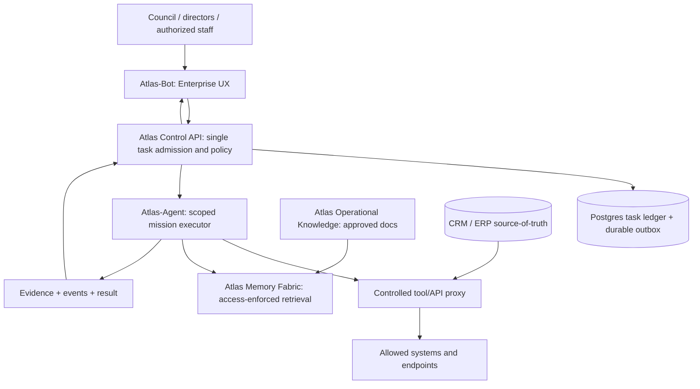

# Reference architecture v0.1

## Organization

Five navigable corporate levels: (1) Governance/Council, (2) Executive Leadership, (3) Shared Services, (4) Business Units & Profit Centers, (5) Labs / Research / Innovation. A level represents authority and reporting, not a software container per manager.

- The **human Council/owner** authorizes policy, budget and strategic priorities.
- **Atlas-Bot** presents managers, executive dashboards, enterprise mission admission, approval queue and oversight.
- An **Atlas control-plane contract** (implemented in Atlas-Bot backend or a future independently deployed service) is the single decision point for organization-wide mission routing and external-action authorization.
- **Atlas-Agent** executes a bounded authorized mission, can call specialized skills and delegate nested tasks within its scope.
- **Atlas-Workforce** contains canonical role slugs, competencies, identities and escalation chain.
- **Atlas-Memory-Fabric** exposes access-controlled knowledge retrieval with provenance.
- **Atlas-Operational-Knowledge** authors, reviews and versions playbooks, FAQs, product guides and scripts.
- CRM/ERP/ARO/BU systems are authoritative for transactional entities, prices, balances, orders and customer state. Knowledge files may link to them but not replace them.

## Control vs execution

No Hermes-internal tool bypass of the enterprise policy proxy. An autonomous nested subagent inherits the parent mission's scope. In phase 01, use a **read-only** tool surface.

## Mission envelope v0 (design, not yet deployed)

Every task MUST carry: `task_id`, `correlation_id`, `tenant_id`, `business_unit_id`, `department_id`, `requested_by`, `assignee_slug`, `purpose`, `data_scope`, `allowed_tools`, `approval_policy`, `cost_limit`, `deadline`, `idempotency_key`, `schema_version`.

Typical lifecycle: `requested -> validated -> policy_checked -> queued -> running -> review_required|completed|failed|cancelled`. All external side effects are recorded with audit evidence. Replay must not duplicate CRM updates, messages or payments.

## Policy and audit boundaries

Authorize tools server-side using tenant/BU, actor, role, data classification, specific operation, temporal validity and approval. Log policy decision ID, execution ID, actor and sanitized evidence. No root Docker sockets, unscoped SSH or direct secrets passed into model prompts.

## Pilot interface

Phase 01 validates one `read-only product FAQ review` requested by a department director, executed by one researcher agent, retrieving one approved fictional BU03 knowledge document, returning source citations and a critic/evidence result. Production channels and customers remain disconnected.

## Operational topology

Use one isolated staging VPC/account where practical: ingress TLS, Atlas-Bot API, Atlas-Agent service, memory adapter, Postgres, optional Redis, background worker, audit store and monitoring. Containerization is not authorization. Confirm resource use, backups, recovery and blast radius before increasing scope.

## Open architecture questions

- OpenBot Intelligence licensing / independence and compatibility.
- Hermes AG-UI adapter or bridge semantics (no assumed direct compatibility).
- Access enforcement and deletion/retention in gbrain.
- Persistent job recovery, approval callback and cancellation semantics.
- Multi-BU isolation at PostgreSQL and knowledge retrieval layers.
