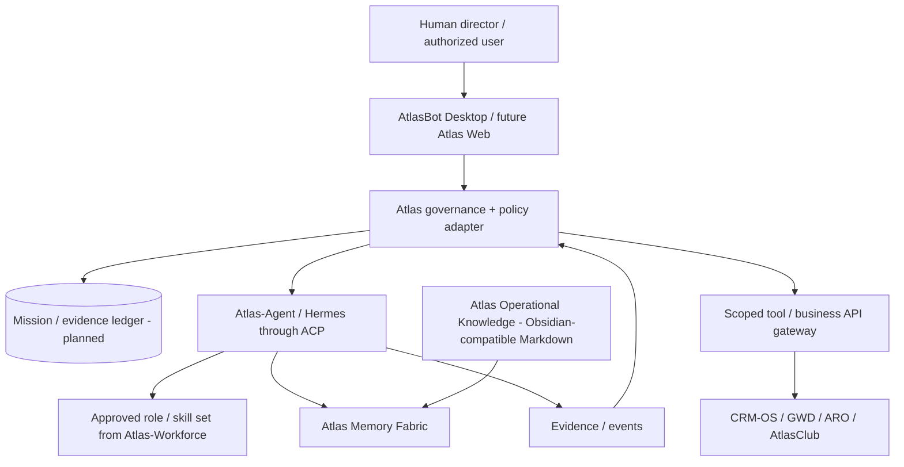

# Atlas Harness — Reference architecture V0.1 (13 November 2026)

**Status:** architectural contract under integration. The current Desktop UX and cloud control plane are not a single deployed multi-tenant product.

## User experience and execution

### Two distinct interface candidates
- **Primary Desktop pilot:** Electron `nightly-labs/openbot` family (`Atlas-Bot-Desktop` planned), local-first persistent agents, SQLite, remote Linux host, ACP and provider adapters. The usual headless remote host does **not** expose a webpage for Caddy; access is from a suitable Desktop or Web client via Account API + Signal + TURN. Self-hosting the remote control plane is a separate project.
- **Research option:** unrelated `CopilotKit/OpenBot` fork `Atlas-Bot` (Tauri / AG-UI / PostgreSQL / CopilotKit Intelligence design). Do not assume its APIs or data models can be transplanted directly to Electron.

### Hermes and legacy continuity
The configured **new Hermes / Atlas-Agent** instance and provider credentials must be preserved and attached to the canonical AtlasBot host using ACP only after verifying the runtime path, user context and security boundaries. The **legacy Hermes** remains in Helena's separate operational perimeter for Helena, Diana, Elisa and Maia, retaining necessary Telegram/Discord channels. Neither perimeter should mount the other's secret stores or workspaces.

### Authority and control
The Atlas governance adapter controls tenant/BU scope, who may delegate, available tools, data classification, budget, review and completion evidence. ACP is the Agent Client Protocol, not a complete authorization/control system. Nested agents inherit scopes. For tests, use fake data and read-only external access. A future durable task ledger may use PostgreSQL but **Supabase is not an automatic requirement for the initial Desktop pilot**.

## Five organizational levels

1. Governance and Council
2. Executive Leadership
3. Shared Services
4. Business Units and Profit Centers
5. Labs, Research and Innovation

These are authority layers, not dedicated containers per executive. Role definitions in Atlas Workforce are declarative; permissions are enforced elsewhere.

## Data domains

- Strategic/board: separate access and retention.
- Employee/private: HR/legal; never in public agent prompts without scoped authorization.
- Approved operational knowledge: versioned Markdown, editorial approvals.
- Business/customer transactions: CRM/ARO/ClubOS systems of record.
- Agent episodic memory: runtime-local checkpoints with appropriate lifecycle.

The GBrain fork provides potential graph/retrieval capabilities; access enforcement, provenance, revocation and cross-tenant isolation still require tests. Obsidian is an optional editor, **not a proprietary server dependency**.

## Deployment topologies

- **V0.1 site:** Next.js on Vercel, early access and roadmap; no downloadable Atlas binaries yet.
- **Internal AtlasHub VPS:** single isolated AtlasBot host (candidate), new Hermes, persistent data, limits and separate network. Helena legacy/projects untouched.
- **Atlas remote services:** Account API (existing upstream Cloudflare Workers + D1 + R2 design), Signal + coturn. Not required for strictly local agents; required by the current remote architecture for independent identity/connectivity. Build only when justified by pilot.
- **AWS staging:** planned, not created. Separate identity/network/budget/backup boundary, approved account and forecast before charges.
- **Community and Enterprise:** prospective product editions, gated on licensing and proven tenancy.

## Initial acceptance test

From the Windows desktop, select the AtlasHub VPS host, create two disposable agent profiles, have one delegate a read-only task to the other, restart the remote host and verify persistence. Then verify Hermes through `hermes acp`, preserving four legacy agents and all named standby projects. No production customer communications or financial actions.

## Mandatory controls

- Stable agent identity, organization scope, tools allowance, budget, idempotency and audit evidence.
- No privileged Docker socket, unrestricted SSH, plaintext secrets in models or cross-tenant mounts.
- Document migrations, backups and rollback before a DB/profile upgrade.
- No public installer or commercial hosting of PolyForm-licensed upstream code until usage rights are established.
