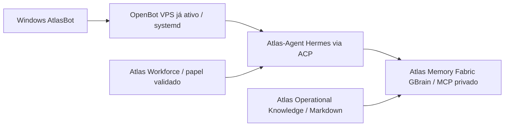

# Atlas-Harness V0.1 — Plano de execução acelerada na VPS
**Data:** 13/11/2026 · **Responsabilidades:** Helena = VPS, Atlas-Local = testes Desktop/ACP, GPTWORK = higienização de `Atlas-Bot-Desktop`.  
**Fonte canónica do código:** repositórios da organização `AtlasHub-Si`. Não utilizar os diretórios GWD nem os clones antigos `sergiomonteiro-atlas` como código oficial atualizado.

## O que está demonstrado no relatório Helena
- Host: 15 GiB RAM, 7,4 GiB disponíveis, 3,5/4 GiB de swap utilizados, `vmstat si/so=0` durante a amostra. Swap ocupado não é equivalente a thrashing ativo. Medir novamente sob carga.
- `openbot.service` já em execução sob systemd, OpenBot v0.69.0, utilizador `openbot`, aproximadamente 1,6 GiB RAM, com Electron/Xvfb/OpenCode. **Reutilizar antes de duplicar**.
- `/srv/atlas-bot-desktop/` tem configuração Docker preparada, container não iniciado. A etiqueta `v1.0.1` alegada no Dockerfile não coincide com a última release pública `nightly-labs/openbot v0.70.0` confirmada na data; verificar antes de qualquer build.
- Quatro Hermes legacy protegidos (Helena, Diana, Elisa, Maia); não assumir Telegram/Discord funcional só porque processo está ativo.
- `/opt/atlas-pilot/src/` contém clones antigos da conta pessoal. `/srv/atlas-harness/` foi criado para a organização lógica.
- GWD `gwd-gbrain` é um serviço de negócio separado; não equivale a `Atlas-Memory-Fabric`. `gwd-crm-os` não é `Atlas-Operational-Knowledge`.

## Objetivo funcional de hoje: uma única vertical slice


Não pretendemos arrancar sete containers. **Workforce** é um catálogo de papéis/skills; **Operational Knowledge** é Markdown controlado, editável em Obsidian; **WorkSwarms** continua laboratório. O único serviço novo potencialmente necessário para a vertical slice é o motor de memória/ligação MCP, se não houver um GBrain Atlas canónico pronto.

### PASSO 1 — HELENA: códigos canónicos e sem interrupção
Executar o helper de forma read-only e depois clonando apenas repositórios que ainda não estejam no diretório novo:
```bash
curl -fsSLo /tmp/atlas-harness-bootstrap.sh \
  https://raw.githubusercontent.com/AtlasHub-Si/Atlas-Harness/main/scripts/bootstrap-canonical-atlas-harness.sh
less /tmp/atlas-harness-bootstrap.sh
bash /tmp/atlas-harness-bootstrap.sh --plan
sudo bash /tmp/atlas-harness-bootstrap.sh --apply
```
Pasta-alvo `/srv/atlas-harness/repos/`. Guarda a tabela de origem e SHA em `/srv/atlas-harness/ops/inventory/CANONICAL-SOURCES.csv`. **Não** move nem altera os projetos em `/opt/atlas-pilot/src`, `/root/.hermes`, `/srv/gwd` ou `/srv/atlas-bot-desktop`. Repositório Desktop excluído intencionalmente até terminar GPTWORK.

### PASSO 2 — HELENA + ATLAS-LOCAL: servidor existente primeiro
Helena verifica, sem divulgar credenciais:
```bash
systemctl is-active openbot.service
systemctl status openbot.service --no-pager
free -h
vmstat 1 5
```
O Atlas-Local abre o servidor existente na aplicação Windows e testa dois agentes fictícios, uma delegação de tarefa de leitura e persistência depois de uma **reconexão**. Não reiniciar serviços da Helena para testar. Se passar, **não** instalar outro OpenBot Docker. Adiar alterações de Desktop, imagem, updater e build até à conclusão de GPTWORK.

### PASSO 3 — ATLAS-LOCAL: Hermes ACP isolado
Confirmar que `hermes` é executável para o utilizador do `openbot.service` (não o `root`) e que possui configuração **própria** autorizada. O cliente invoca `hermes acp` na identidade do processo OpenBot. Não copiar `/root/.hermes` ou perfis da Helena para o utilizador OpenBot. Usar credenciais limitadas ao laboratório e dados fictícios. Prova: agente Hermes no AtlasBot conclui tarefa sem exposição de segredos.

### PASSO 4 — ATLAS-LOCAL: Memória GBrain, conhecimento e papéis
- Usar **somente o clone `AtlasHub-Si/Atlas-Memory-Fabric`**, distinto do antigo GWD GBrain. Instalar/ativar de acordo com os comandos e requisitos da versão fixada no inventário; isolar HOME, armazenamento e credenciais. O repositório avisa que o pacote npm chamado `gbrain` é outro projeto: **não executar `npm install -g gbrain`**.
- Criar **brain só para testes** e disponibilizar MCP apenas em loopback/rede privada autorizada. **Não usar Funnel público nem dados Helena/GWD**.
- `Atlas-Operational-Knowledge`: usar o documento sintético da pasta `examples/BU03-DEMO`, verificar frontmatter, aprovação e âmbito. Obsidian é um editor opcional; **não necessita daemon Docker**.
- `Atlas-Workforce`: selecionar um papel e verificar manualmente instruções, permissões e skill boundaries antes de o carregar no agente.
- Prova ponta a ponta: criar tarefa Windows → Hermes ACP → papel Workforce → consulta a um conhecimento autorizado na GBrain → resposta com origem/citação; ensaiar recusa de âmbito e revogação.

### PASSO 5 — Capacidade, standby e segurança
`MemAvailable=7,4 GiB` é suficiente para **testes dirigidos**, não uma reserva garantida para mais uma stack permanente. Acompanhar `free -h`, `vmstat`, `docker stats`, latência e OOM. 
- Como opção reversível **após verificar dependências**, parar somente `atlas-clubos-p1` (~380 MiB), `atlas-learnhouse-clean` (~344 MiB), `atlas-maic-lab` (~192 MiB) e `mypets-api` (~46 MiB) se estiverem realmente inativos. Potencial aproximado de 962 MiB, não uma garantia de aumento direto de MemAvailable.
- **Não parar** `sales-ai`, `atendimento-center`, Chatwoot/Evolution, ARO, media ou CRM sem mapear dependências do negócio.
- Não efetuar `swapoff`, `drop_caches`, prune, alterações do daemon Docker, DNS/Caddy ou reinícios globais.

## Aceitação e relatório
1. SHA e origem canónica de cada repo em `/srv/atlas-harness/repos`.
2. Windows ↔ servidor existente PASS/FAIL, agente delega, persiste na reconexão.
3. Hermes ACP PASS/FAIL sob utilizador isolado.
4. GBrain/MCP privado PASS/FAIL com dados fictícios.
5. Conhecimento aprovado/citado e papel Workforce PASS/FAIL; teste de recusa/revogação.
6. Quatro agentes legacy e aplicações protegidas sem regressão; consumo RAM/swap antes/depois.
7. Bloqueios concretos para o próximo passo.

**Não declarar o conjunto instalado ou integrado sem provas da execução.** A utilização comercial e distribuição do OpenBot derivado continuam dependentes dos direitos originais PolyForm Noncommercial.
